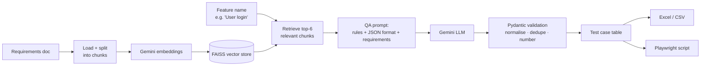

# 🧪 AI Test Case Generator

Turn a requirements document (SRS, user stories, feature spec) into **structured, traceable test cases** in seconds, then into **starter Playwright automation scripts**.

Writing test cases by hand from long requirement documents is one of the slowest parts of QA. This tool uses **Retrieval-Augmented Generation (RAG)** to find the requirements for the feature you name, and an LLM (Google Gemini) to draft positive, negative, edge and boundary test cases a tester can review, export to Excel and automate.


## Features

- 📄 **Upload** a PDF, DOCX, TXT or Markdown file, or **paste** notes / user stories
- 🔎 **RAG retrieval:** only the requirements relevant to the chosen feature are sent to the LLM, so output stays grounded and traceable
- ✅ **Structured test cases:** ID, title, requirement covered, type, priority, preconditions, steps, test data, expected result
- 🧭 **Traceability:** every case names the requirement it verifies (e.g. `LOG-03`), and the retrieved requirement text is shown
- 📊 **Coverage summary:** counts by test type and priority
- 🧾 **Coverage check:** shows which requirement IDs have a test case and flags IDs the model may have invented
- ⏱️ **Reliable calls:** request timeout, limited retries and an automatic fallback model
- ⬇️ **Export** to a formatted Excel sheet or CSV, ready for a test management tool
- 🤖 **Automation:** converts any test case into a pytest-playwright script
- 🛡️ **Validation:** LLM output is checked with Pydantic; labels are normalised, duplicates removed, bad replies fail with clear messages
- 🧪 **65 offline tests** with a fake LLM, run on every push via GitHub Actions

## How it works



## Tech stack

| Part | Tool |
|---|---|
| LLM orchestration | LangChain (LCEL) |
| LLM + embeddings | Google Gemini (free tier) |
| Vector database | FAISS |
| Output validation | Pydantic |
| Export | openpyxl (Excel), csv |
| UI | Streamlit |
| Testing | Pytest, fake LLM + deterministic fake embeddings |
| CI | GitHub Actions |

## Project structure

```
ai-testcase-generator/
├── app.py                  # Streamlit UI
├── testgen/
│   ├── config.py           # settings (models, chunk size, top-k, limits)
│   ├── ingest.py           # load PDF/TXT/MD + split into chunks
│   ├── vectorstore.py      # embeddings + FAISS + retriever
│   ├── models.py           # Gemini chat + embedding models
│   ├── schema.py           # Pydantic TestCase / TestSuite
│   ├── generator.py        # RAG: retrieve → prompt → generate → validate
│   ├── coverage.py         # requirement-ID coverage report (no LLM)
│   ├── parsing.py          # JSON extraction, dedupe, numbering (no LLM)
│   ├── scriptgen.py        # test case → Playwright script
│   └── export.py           # Excel + CSV
├── tests/                  # 65 tests, no API key needed
├── sample_docs/
│   └── foodies_paradise_srs.pdf   # sample SRS with 29 requirements
└── .github/workflows/tests.yml
```

## Run it locally

**Requirements:** Python 3.10+

```bash
git clone https://github.com/Anchita-p/ai-testcase-generator.git
cd ai-testcase-generator

python -m venv venv
venv\Scripts\activate            # Windows
# source venv/bin/activate       # macOS / Linux

pip install -r requirements.txt

copy .env.example .env           # macOS/Linux: cp .env.example .env
# open .env and paste your free key from https://aistudio.google.com/apikey

streamlit run app.py
```

Then upload `sample_docs/foodies_paradise_srs.pdf`, click **Process document**, and try features like:

- `User login`: expect lockout after 5 attempts, case-insensitive email, session timeout
- `User registration`: expect password rules (8–20 chars, boundary tests at 7/8/20/21)
- `Profile photo upload`: expect JPG/PNG only, 2 MB limit
- `Recipe search by ingredients`: expect 1–10 ingredient limits, no-results message

## Run the tests

```bash
pytest
```

Unit tests replace the real LLM and embeddings with fakes, so they are deterministic, fast, free and run offline. They cover document loading, chunking, retrieval, prompt content, LLM-output validation (bad JSON, missing fields, odd labels, duplicates), input limits, Excel/CSV export and script extraction.

## Evaluation

`python -m testgen.evaluate --models <model1>,<model2>` generates test cases for four features of the sample SRS and scores them against a hand-written reference (`evaluation/reference.json`): requirement coverage, key checks (e.g. login lockout must mention 5 attempts and 15 minutes), test-type variety and invented requirement IDs.

| Model | Valid runs | Req. coverage | Key checks passed | Types present | Invented IDs | Avg seconds |
|---|---|---|---|---|---|---|
| gemini-3.5-flash-lite | 4/4 | 100% | 100% | 100% | 0 | 5.2 |
| gemini-3.1-flash-lite | 4/4 | 100% | 80% | 92% | 0 | 4.2 |
| gemini-3.5-flash | 1/4 | 100% | 100% | 100% | 0 | 13.2 |

Small sample (one run per feature), so read it as a quick quality signal, not proof. `gemini-3.5-flash` often returned "503 overloaded" during the run, so its row is not comparable. This is why calls have a timeout and a fallback model.

## Limitations

- Generated cases are a **first draft for a tester to review**, not a replacement for one.
- Playwright scripts use guessed selectors marked `# TODO: confirm selector`.
- Scanned (image-only) PDFs aren't supported without OCR.
- Smaller/faster models (e.g. flash-lite) can be less thorough; set `CHAT_MODEL` in `.env` to trade speed for detail.

## Roadmap

- Export directly to JIRA / TestRail
- Generate API test cases from an OpenAPI spec
- Evaluate generated cases against a hand-written reference set
